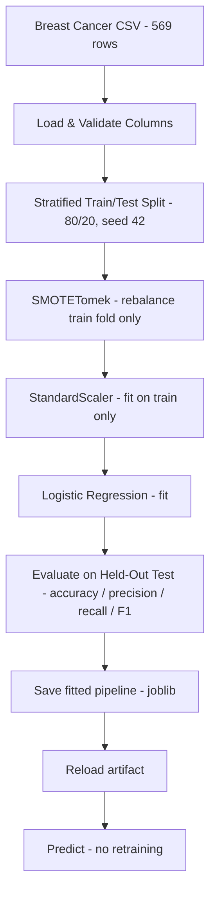

# 🎗️ ML Production Project — Breast Cancer Classification

[](https://www.python.org/)
[](https://scikit-learn.org/)
[](https://imbalanced-learn.org/)
[](https://docs.astral.sh/uv/)
[](https://docs.astral.sh/ruff/)
[](https://github.com/psf/black)
[](LICENSE)

**ML Production Project** is a production-ready **binary classification** application that predicts whether a breast tumor is **malignant** or **benign** from 30 cytological measurements. The project began as an experimentation notebook (`notebooks/01_exploration.ipynb`) and was refactored into a clean, reproducible Python package: environment-driven configuration, structured logging, a leakage-safe scikit-learn pipeline saved with joblib, and a `train` / `predict` CLI that serves the saved artifact without retraining.

---

## ✨ Key Features

### 📓 1. Notebook-First Experimentation → Production Modules
- Stage A lives in `notebooks/01_exploration.ipynb`: EDA, null/outlier checks, class distribution, 7-model comparison, and metric plots — the full experimentation record.
- Stage B moves only the tested logic into the `production_app/` package (data, preprocessing, training, evaluation, model service, config, logging) — the modules are the source of truth; the notebook is never imported by the app.

### 🛡️ 2. Leakage-Safe Training Pipeline
- A single `imblearn.pipeline.Pipeline` chains **SMOTETomek → StandardScaler → Logistic Regression**.
- The sampler and scaler only learn during `fit` on training data; `predict` skips the sampler and applies the already-fitted transform — no test data ever leaks into training.
- `SMOTETomek` rebalances the 63/37 class imbalance (benign/malignant) inside the training fold only.

### ⚙️ 3. Config-Driven Train / Predict CLI
- Every runtime setting (dataset path, model artifact path, log level, environment, test size, random seed) is read from environment variables via `config.py` — nothing is hardcoded.
- `uv run run.py train` fits, evaluates, saves the pipeline, and verifies the save/reload roundtrip.
- `uv run run.py predict` loads the saved artifact and predicts — **no retraining**, ever.

### 🧰 4. Reproducible & Code-Quality Enforced
- **uv** manages Python 3.14, dependencies, and the lockfile (`uv.lock` committed) — one `uv sync` reproduces the exact environment.
- **Ruff**, **Black**, and **pre-commit** hooks are configured and passing; all operational events go through `logging` (no `print`).

---

## 📖 From Notebook to Production

| Stage | Where | What |
|-------|-------|------|
| **Stage A — Experiment** | `notebooks/01_exploration.ipynb` | Load & inspect the dataset, encode the target, visualize distributions/outliers/correlations, train 7 classifiers (Logistic Regression, Random Forest, XGBoost, Decision Tree, Naive Bayes, KNN, SVC), compare metrics, save baseline pickles. |
| **Stage B — Engineer** | `production_app/` + `run.py` | Refactor the validated workflow into typed, logged, config-driven modules; ship **one** straightforward model (Logistic Regression) behind a joblib-saved pipeline; run training and prediction independently of the notebook. |

---

## 🏗️ ML Pipeline Architecture



---

## 📊 Evaluation Results

Held-out test set (20%, stratified, `RANDOM_STATE=42`):

| Metric | Value |
|--------|-------|
| **Accuracy** | **0.9737** |
| Precision (malignant) | 0.9756 |
| Recall (malignant) | 0.9524 |
| F1 (malignant) | 0.9639 |

Confusion matrix (`[[TN, FP], [FN, TP]]`):

```
[[71  1]
 [ 2 40]]
```

One false positive and two false negatives out of 114 test samples — recall on the malignant class is the clinically weighted number, and it is explicitly reported and logged on every training run.

---

## 🛠️ Technology Stack

### Core
- **Language**: Python 3.14
- **Environment & packaging**: [uv](https://docs.astral.sh/uv/) (`.venv` + `uv.lock`)

### ML / Data
- **Model**: scikit-learn Logistic Regression
- **Pipeline**: imbalanced-learn `Pipeline` (SMOTETomek + StandardScaler)
- **Serialization**: joblib (fitted pipeline artifact)
- **Data**: pandas, numpy — [Breast Cancer Wisconsin (Diagnostic)](https://www.kaggle.com/datasets/yasserh/breast-cancer-dataset), 569 rows × 32 columns, no missing values

### Experimentation (notebook only)
- Jupyter / ipykernel, Plotly, Seaborn, Matplotlib, XGBoost (model comparison)

### Code Quality
- Ruff (lint), Black (format), pre-commit hooks

---

## 🚀 Getting Started

### Prerequisites
- **[uv](https://docs.astral.sh/uv/)** (installs and manages Python 3.14 automatically)
- **Git**

### 1. Repository Setup
```bash
git clone https://github.com/MarwanAbdellah/ML-Production_Project.git
cd ML-Production_Project
```

### 2. Install Dependencies
```bash
uv sync
```

### 3. Configure Environment
Copy the example environment file and edit values if needed (the app runs on safe defaults without a `.env`):
```bash
cp .env.example .env
```
```env
DATA_PATH=notebooks/kaggle/breast-cancer.csv
MODEL_PATH=models/model_pipeline.joblib
LOG_LEVEL=INFO
ENVIRONMENT=development
TEST_SIZE=0.2
RANDOM_STATE=42
```

| Variable | Default | Purpose |
|----------|---------|---------|
| `DATA_PATH` | `notebooks/kaggle/breast-cancer.csv` | Input dataset location |
| `MODEL_PATH` | `models/model_pipeline.joblib` | Saved pipeline artifact |
| `LOG_LEVEL` | `INFO` | Logging verbosity |
| `ENVIRONMENT` | `development` | Environment label (logged) |
| `TEST_SIZE` | `0.2` | Test fraction of the split |
| `RANDOM_STATE` | `42` | Seed for split + SMOTETomek |

### 4. Train
```bash
uv run run.py train
```
Loads the dataset, splits, fits the pipeline, logs metrics + classification report + confusion matrix, saves `models/model_pipeline.joblib`, and verifies the save/reload roundtrip.

### 5. Predict with the Saved Artifact
```bash
# Default: predict on 5 sample rows from the dataset
uv run run.py predict

# Or on your own CSV with the same 30 feature columns
uv run run.py predict --input path/to/data.csv
```
Prediction loads the saved pipeline and runs inference — **no retraining**.

---

## 🧪 Testing & Verification

There is no separate test suite; verify the system with these checks:

1. `uv run run.py train` — exits 0, logs evaluation metrics (accuracy ≈ 0.97), and reports `Saved pipeline to models\model_pipeline.joblib` followed by `Save/reload roundtrip verified`.
2. `uv run run.py predict` — logs `Loaded pipeline from ...` and prints 5 predictions; no training logs appear.
3. Failure path: delete or rename `models/model_pipeline.joblib`, then `uv run run.py predict` — logs `Model artifact not found` and exits with code 1.
4. Code quality: `uv run ruff check .`, `uv run black --check .`, and `uv run pre-commit run --all-files` all pass.
5. Reproducibility: run `train` twice — identical metrics both times (everything is seeded).

---

## 📁 Project Structure

```text
ML-Production_Project/
├── notebooks/
│   ├── 01_exploration.ipynb        # Stage A: EDA, 7-model comparison, validation record
│   └── kaggle/
│       └── breast-cancer.csv       # Breast Cancer Wisconsin dataset (569 x 32)
├── production_app/                 # Stage B: production package (source of truth)
│   ├── __init__.py                 # Package marker
│   ├── config.py                   # Env-driven settings (paths, seed, log level)
│   ├── logging_config.py           # One shared logging setup + get_logger
│   ├── data.py                     # Load, validate, feature prep, stratified split
│   ├── preprocessing.py            # SMOTETomek -> StandardScaler -> LogReg pipeline
│   ├── training.py                 # Fit with timing + logging
│   ├── evaluation.py               # Accuracy / precision / recall / F1 + report
│   ├── model_service.py            # joblib save / load / predict
│   └── main.py                     # run_training() / run_prediction() orchestration
├── models/
│   ├── model_pipeline.joblib       # Saved fitted pipeline (recreated by `train`)
│   └── joblib_models/              # Baseline pickles from the notebook
├── run.py                          # CLI entry point: train | predict [--input]
├── .env.example                    # Environment variable template
├── .gitignore                      # Ignores .venv, .env, caches, checkpoints
├── .pre-commit-config.yaml         # ruff + black + file-check hooks
├── pyproject.toml                  # Dependencies, dev tools, tool config
├── uv.lock                         # Locked reproducible environment
└── README.md                       # This file
```

---

## 👤 Author

**Marwan Abdellah**
- **GitHub**: [@MarwanAbdellah](https://github.com/MarwanAbdellah)
- **LinkedIn**: [Marwan Abdellah](https://www.linkedin.com/in/marwan-abdellah/)

---

## 📄 License

Distributed under the MIT License. See [`LICENSE`](LICENSE) for more information.
