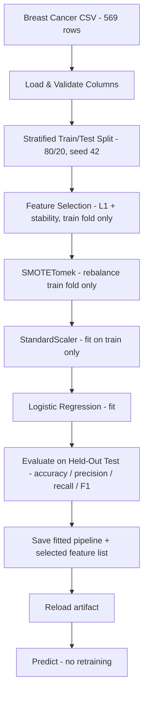
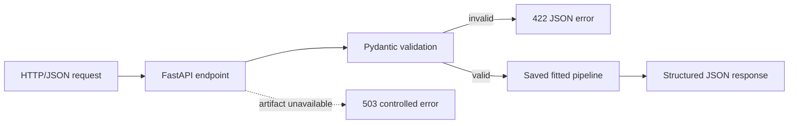

# 🎗️ ML Production Project — Breast Cancer Classification

[](https://www.python.org/)
[](https://scikit-learn.org/)
[](https://imbalanced-learn.org/)
[](https://docs.astral.sh/uv/)
[](https://fastapi.tiangolo.com/)
[](https://docs.pydantic.dev/)
[](https://docs.astral.sh/ruff/)
[](https://github.com/psf/black)
[](LICENSE)

**ML Production Project** is a production-ready **binary classification** application that predicts whether a breast tumor is **malignant** or **benign** from **8 selected cytological measurements** (reduced from 30 during Assignment 03). The project began as an experimentation notebook (`notebooks/01_exploration.ipynb`) and was refactored into a clean, reproducible Python package: environment-driven configuration, structured logging, a leakage-safe scikit-learn pipeline saved with joblib, and a `train` / `predict` CLI that serves the saved artifact without retraining.

**Assignment 02** extended the same project — same dataset, same fitted pipeline, same repository — with a **FastAPI service** that exposes the saved model over HTTP. Requests are validated by **Pydantic**, so malformed or out-of-range inputs are rejected before they ever reach the model, and the model is loaded once and reused rather than retrained per request.

**Assignment 03** adds four things on top, still in the same repository: **feature selection** (30 → 8 inputs, same test performance), a **Streamlit** form that talks to the API over HTTP, a **Docker** image that runs the API, and a **pytest** suite that checks the model and the API contract.

---

## ✨ Key Features

### 📓 1. Notebook-First Experimentation → Production Modules
- Stage A lives in `notebooks/01_exploration.ipynb`: EDA, null/outlier checks, class distribution, 7-model comparison, and metric plots — the full experimentation record.
- Stage B moves only the tested logic into the `production_app/` package (data, preprocessing, training, evaluation, model service, config, logging) — the modules are the source of truth; the notebook is never imported by the app.
- Stage C lives in `notebooks/02_feature_selection.ipynb`: the Filter vs Wrapper vs Embedded comparison and the stability analysis behind the final 8 features.

### 🛡️ 2. Leakage-Safe Training Pipeline
- A single `imblearn.pipeline.Pipeline` chains **SMOTETomek → StandardScaler → Logistic Regression**.
- The sampler and scaler only learn during `fit` on training data; `predict` skips the sampler and applies the already-fitted transform — no test data ever leaks into training.
- `SMOTETomek` rebalances the 63/37 class imbalance (benign/malignant) inside the training fold only.
- Feature selection runs on the training fold only, and the resulting names are saved next to the artifact — the test set never decides which features survive.

### ⚙️ 3. Config-Driven Train / Predict CLI
- Every runtime setting (dataset path, model artifact path, selected-feature list, log level, environment, test size, random seed) is read from environment variables into a single frozen `Settings` dataclass (`production_app/config.py`), exposed as `settings` — nothing is hardcoded.
- `uv run run.py train` selects features, fits, evaluates, saves the pipeline plus the selected-feature list, and verifies the save/reload roundtrip.
- `uv run run.py predict` loads the saved artifact and predicts — **no retraining**, ever.

### 🧰 4. Reproducible & Code-Quality Enforced
- **uv** manages Python 3.14, dependencies, and the lockfile (`uv.lock` committed) — `uv sync` reproduces the exact app environment, `uv sync --group ui` adds Streamlit, and `uv sync --group experiments` adds the notebook tooling.
- **Ruff**, **Black**, and **pre-commit** hooks are configured and passing; all operational events go through `logging` (no `print`).

### 🌐 5. Validated HTTP API (Assignment 02)
- `production_app/api.py` exposes `GET /health` and `POST /predict`; the endpoints stay thin and delegate all ML work to `model_service.py`.
- `production_app/schemas.py` declares the 8 selected features as one reusable constrained type — non-negative and finite (`allow_inf_nan=False`) — with `extra="forbid"`, plus the response contract; negative, non-finite, missing, or unexpected input never reaches the model.
- `config.py` centralizes every setting in one frozen `@dataclass` (`settings`), still populated from `.env`.
- Failures are controlled: bad input → `422`, unloadable artifact → `503`, unexpected errors → `500` with a generic message (no stack traces, paths or secrets ever reach the client).

### 🔬 6. Feature Selection (Assignment 03)
- Embedded **L1 logistic regression** (`LogisticRegressionCV`) picks features on the training fold, then a stability filter keeps only what survives in at least 4 of 5 resamples.
- 30 → **8 features** with identical test accuracy and F1 (0.9737 / 0.9639) — fewer inputs to collect, not a better model.
- Full comparison against Filter and Wrapper methods: `notebooks/02_feature_selection.ipynb`.

### 🖥️ 7. Streamlit UI (Assignment 03)
- `streamlit_app.py` renders the 8 selected inputs, prefills median benign values, and offers one-click benign/malignant examples.
- It calls the API over HTTP (`API_URL`, default `http://localhost:8000`) and never loads or trains the model itself.
- Validation errors (`422`), an unavailable model (`503`), timeouts, and connection failures each get their own message.

### 🐳 8. Docker + Tests (Assignment 03)
- `Dockerfile` builds the API on `python:3.14-slim` with a reproducible `uv sync --frozen --no-dev`; the `ui` target adds Streamlit for the optional Compose demo.
- `docker-compose.yml` starts both containers, with the UI waiting for the API healthcheck.
- `pytest` covers the artifact/feature contract, inference, both endpoints, validation rejections, and the missing-artifact path.

---

## 📖 From Notebook to Production

| Stage | Where | What |
|-------|-------|------|
| **Stage A — Experiment** | `notebooks/01_exploration.ipynb` | Load & inspect the dataset, encode the target, visualize distributions/outliers/correlations, train 7 classifiers (Logistic Regression, Random Forest, XGBoost, Decision Tree, Naive Bayes, KNN, SVC), compare metrics, save baseline pickles. |
| **Stage B — Engineer** | `production_app/` + `run.py` | Refactor the validated workflow into typed, logged, config-driven modules; ship **one** straightforward model (Logistic Regression) behind a joblib-saved pipeline; run training and prediction independently of the notebook. |
| **Stage C — Reduce** | `notebooks/02_feature_selection.ipynb` + `production_app/feature_selection.py` | Compare Filter / Wrapper / Embedded selection on the training fold, keep the stable L1 subset, retrain the same pipeline on 8 columns, and save the feature list alongside the artifact. |

---

## 🏗️ ML Pipeline Architecture



---

## 📊 Evaluation Results

Held-out test set (20%, stratified, `RANDOM_STATE=42`):

| Metric | Value |
|--------|-------|
| **Accuracy** | **0.9737** |
| Precision (malignant) | 0.9756 |
| Recall (malignant) | 0.9524 |
| F1 (malignant) | 0.9639 |

Confusion matrix (`[[TN, FP], [FN, TP]]`):

```
[[71  1]
 [ 2 40]]
```

One false positive and two false negatives out of 114 test samples — recall on the malignant class is the clinically weighted number, and it is explicitly reported and logged on every training run.

### Feature selection: baseline vs selected

Selection is fitted on the training fold only; the test set is scored once, at the end
(`notebooks/02_feature_selection.ipynb`).

| Method | Features | Accuracy | Precision | Recall | F1 | 5-fold CV F1 (train) |
|--------|----------|----------|-----------|--------|----|----------------------|
| **Task 02 baseline (all features)** | 30 | 0.9737 | 0.9756 | 0.9524 | 0.9639 | 0.9643 |
| Filter — `f_classif`, k=12 | 12 | 0.9825 | 0.9545 | 1.0000 | 0.9767 | 0.9185 |
| Filter — `mutual_info`, k=15 | 15 | 0.9825 | 0.9762 | 0.9762 | 0.9762 | 0.9133 |
| Embedded — L1, CV-chosen C | 14 | 0.9649 | 0.9524 | 0.9524 | 0.9524 | 0.9583 |
| Wrapper — RFECV | 19 | 0.9649 | 0.9750 | 0.9286 | 0.9512 | 0.9669 |
| **Task 03 final — L1 + stability** | **8** | **0.9737** | **0.9756** | **0.9524** | **0.9639** | 0.9585 |

**How to read this:** the filter rows look best on the 114-row test set but have the *worst*
training-fold CV F1 — that is luck, not a better model. RFECV is affordable here but only removes
11 of 30 features. The chosen method keeps the baseline's test metrics exactly while cutting the
input contract from 30 to 8 fields.

**Final 8 features** (dataset order, also the order the pipeline was fitted on):

```text
concave points_mean, radius_se, radius_worst, texture_worst,
smoothness_worst, concavity_worst, concave points_worst, symmetry_worst
```

They are persisted to `models/selected_features.json`; `run.py train` asserts that the freshly
selected list matches the Pydantic schema, so artifact, API and UI cannot drift apart silently.

---

## 🛠️ Technology Stack

### Core
- **Language**: Python 3.14
- **Environment & packaging**: [uv](https://docs.astral.sh/uv/) (`.venv` + `uv.lock`)

### ML / Data
- **Model**: scikit-learn Logistic Regression
- **Pipeline**: imbalanced-learn `Pipeline` (SMOTETomek + StandardScaler)
- **Serialization**: joblib (fitted pipeline artifact)
- **Data**: pandas, numpy — [Breast Cancer Wisconsin (Diagnostic)](https://www.kaggle.com/datasets/yasserh/breast-cancer-dataset), 569 rows × 32 columns, no missing values

### Experimentation (notebook only — `uv sync --group experiments`)
- Jupyter / ipykernel, nbconvert, Plotly, Seaborn, Matplotlib, XGBoost (model comparison)
- None of these are imported by `production_app/` or `run.py`; the production app installs and runs without them.

### Code Quality
- Ruff (lint), Black (format), pre-commit hooks

### API (Assignment 02)
- **FastAPI** + **Uvicorn** (HTTP service, auto-generated OpenAPI docs at `/docs`)
- **Pydantic v2** (request/response validation and typed schemas)

### UI, Containers & Tests (Assignment 03)
- **Streamlit** + **requests** (`ui` group — never installed in the API image)
- **Docker** (`python:3.14-slim`, `uv sync --frozen`) and Docker Compose for the optional two-container demo
- **pytest** + **httpx2** (`dev` group)

---

## 🚀 Getting Started

### Prerequisites
- **[uv](https://docs.astral.sh/uv/)** (installs and manages Python 3.14 automatically)
- **Git**

### 1. Repository Setup
```bash
git clone https://github.com/MarwanAbdellah/ML-Production_Project.git
cd ML-Production_Project
```

### 2. Install Dependencies
```bash
uv sync
```
That is everything the training CLI and the API need. Add the groups you actually use:
```bash
uv sync --group ui            # Streamlit interface
uv sync --group experiments   # notebooks (matplotlib, plotly, nbconvert, xgboost)
```

### 3. Configure Environment
Copy the example environment file and edit values if needed (the app runs on safe defaults without a `.env`):
```bash
cp .env.example .env
```
```env
DATA_PATH=notebooks/kaggle/breast-cancer.csv
MODEL_PATH=models/model_pipeline.joblib
SELECTED_FEATURES_PATH=models/selected_features.json
LOG_LEVEL=INFO
ENVIRONMENT=development
TEST_SIZE=0.2
RANDOM_STATE=42
API_URL=http://localhost:8000
```

| Variable | Default | Purpose |
|----------|---------|---------|
| `DATA_PATH` | `notebooks/kaggle/breast-cancer.csv` | Input dataset location |
| `MODEL_PATH` | `models/model_pipeline.joblib` | Saved pipeline artifact |
| `SELECTED_FEATURES_PATH` | `models/selected_features.json` | Selected feature names and order |
| `LOG_LEVEL` | `INFO` | Logging verbosity |
| `ENVIRONMENT` | `development` | Environment label (logged) |
| `TEST_SIZE` | `0.2` | Test fraction of the split |
| `RANDOM_STATE` | `42` | Seed for split + SMOTETomek + selection |
| `API_URL` | `http://localhost:8000` | Streamlit → API base URL (Streamlit only) |

These values are read once at import into a single frozen `Settings` dataclass (`production_app/config.py`) and consumed everywhere as `settings` (e.g. `settings.model_path`).

### 4. Train
```bash
uv run run.py train
```
Loads the dataset, splits, fits the pipeline, logs metrics + classification report + confusion matrix, saves `models/model_pipeline.joblib`, and verifies the save/reload roundtrip.

### 5. Predict with the Saved Artifact
```bash
# Default: predict on 5 sample rows from the dataset
uv run run.py predict

# Or on your own CSV with the same 30 feature columns
uv run run.py predict --input path/to/data.csv
```
Prediction loads the saved pipeline and runs inference — **no retraining**.

### 6. Serve the API
```bash
uv run uvicorn production_app.api:app --port 8000   # Ctrl+C to stop
```
Swagger UI: <http://127.0.0.1:8000/docs>. Full endpoint contract, examples and troubleshooting: [Assignment 02 — FastAPI Service](#-assignment-02--fastapi-service).

---

## 🌐 Assignment 02 — FastAPI Service

Assignment 02 extends **this same repository**. It adds a validated HTTP layer in front of the pipeline that Task 01 already fitted and saved: nothing is retrained or refitted inside a request.

### What Assignment 02 adds

| Item | Status | Purpose |
|------|--------|---------|
| `production_app/schemas.py` | **New** | Pydantic request/response models (the selected features, class output) |
| `production_app/api.py` | **New** | FastAPI app implementing `/health` and `/predict` |
| `production_app/model_service.py` | Extended | `load_model()` now caches the artifact — loaded once, reused per request |
| `production_app/config.py` | Extended | All settings live in one frozen `Settings` dataclass |
| `pyproject.toml` / `uv.lock` | Updated | `fastapi` + `uvicorn[standard]` added with uv |
| Task 01 modules, dataset, CLI, notebook | Unchanged | Same features, order, labels, split, and saved artifact |

### Request flow



1. Uvicorn routes the request to `predict_endpoint` in `api.py`.
2. FastAPI parses the body into `PredictRequest` (`schemas.py`): the 8 selected features (30 before Assignment 03), all required, typed as `float`, constrained to `>= 0` and finite. Missing, non-numeric, negative, non-finite, or unexpected values get a `422` — the pipeline is never called.
3. `PredictRequest.to_frame()` builds a one-row DataFrame in the exact column order the artifact was fitted on; `model_service.predict()` runs inference through the fitted preprocessing (sampler skipped, scaler reused — no refitting).
4. The endpoint answers `200` with the predicted class, its readable label, and the malignant probability.
5. Model access goes through `model_service.load_model()`, which is cached with `lru_cache`: the joblib artifact is read once per process. A missing or corrupt artifact becomes a controlled `503`; unexpected errors become a generic `500`. Clients never see stack traces, filesystem paths or configuration values.

### Running the API

```bash
# 1. Install/refresh dependencies (adds fastapi + uvicorn)
uv sync

# 2. Ensure the saved artifact exists (already committed; this regenerates it if missing)
uv run run.py train

# 3. Start the service, then stop it with Ctrl+C
uv run uvicorn production_app.api:app --port 8000

# 4. Auto-generated documentation
#    http://127.0.0.1:8000/docs    -> Swagger UI
#    http://127.0.0.1:8000/redoc   -> ReDoc
#    http://127.0.0.1:8000/openapi.json
```

### `GET /health`

Reports whether the service can actually load its model artifact.

```bash
curl -i http://127.0.0.1:8000/health
```

```json
HTTP/1.1 200 OK
{"status": "ok", "model_loaded": true, "detail": null}
```

| Situation | Status | Body |
|-----------|--------|------|
| Artifact loads | `200` | `{"status": "ok", "model_loaded": true, "detail": null}` |
| Artifact missing or unreadable | `503` | `{"status": "unhealthy", "model_loaded": false, "detail": "model artifact unavailable"}` |

### `POST /predict`

Accepts **one** observation with the 8 selected features. Every field below is required; all are non-negative, finite numbers.

```bash
curl -X POST http://127.0.0.1:8000/predict \
  -H "Content-Type: application/json" \
  -d '{
    "concave points_mean": 0.1471, "radius_se": 1.095,
    "radius_worst": 25.38, "texture_worst": 17.33,
    "smoothness_worst": 0.1622, "concavity_worst": 0.7119,
    "concave points_worst": 0.2654, "symmetry_worst": 0.4601
  }'
```

```json
HTTP/1.1 200 OK
{"prediction": 1, "label": "malignant", "probability": 0.9999997333856385}
```

| Field | Type | Meaning |
|-------|------|---------|
| `prediction` | `int` | `0` = benign, `1` = malignant (Task 01 labels) |
| `label` | `str` | Human-readable class: `benign` or `malignant` |
| `probability` | `float \| null` | Malignant probability; `null` when the model has no `predict_proba` |

Feature names are exactly the dataset columns, in the order the pipeline was fitted on (the 2 names containing a space must be quoted in JSON). The list is also saved in `models/selected_features.json`:

```text
"concave points_mean", radius_se, radius_worst, texture_worst,
smoothness_worst, concavity_worst, "concave points_worst", symmetry_worst
```

### Expected validation errors

Malformed input is rejected with `422` before inference, with a machine-readable `detail` array:

| Case | Response |
|------|----------|
| Missing feature | `{"detail": [{"type": "missing", "loc": ["body", "symmetry_worst"], "msg": "Field required", ...}]}` |
| Non-numeric value (`texture_worst: "abc"`) | `{"detail": [{"type": "float_parsing", "loc": ["body", "texture_worst"], "msg": "Input should be a valid number, unable to parse string as a number", ...}]}` |
| Negative value (`radius_worst: -1`) | `{"detail": [{"type": "greater_than_equal", "loc": ["body", "radius_worst"], "msg": "Input should be greater than or equal to 0", "ctx": {"ge": 0.0}}]}` |
| Non-finite value (`radius_worst: NaN`) | `422` with a `finite_number` error |
| Unexpected extra feature | `422` with an `extra_forbidden` error (`extra="forbid"`) |
| Artifact unavailable (any valid request) | `503` `{"detail": "model artifact unavailable"}` |

### Troubleshooting

| Symptom | Cause / fix |
|---------|-------------|
| `/health` returns `503` | No artifact at `MODEL_PATH`. Run `uv run run.py train`, or point `MODEL_PATH` at the real file in `.env`. |
| `422` on a feature you are sure you sent | The 2 columns with a space need the exact dataset spelling: `"concave points_mean"`, `"concave points_worst"` (underscores are only used in Python). |
| `422` `extra_forbidden` | Only the 8 selected features are accepted; the other 22 Task 01 columns are no longer part of the contract. |
| Predictions look random | Column order/names must match `models/selected_features.json`; the schema enforces this. |
| `Address already in use` | Another process holds the port: `uv run uvicorn production_app.api:app --port 8001`. |
| Old model still served after retraining | `load_model()` caches per process — restart the API to pick up a newly trained artifact. |
| `ModuleNotFoundError: fastapi` | Dependencies are stale: `uv sync`. |
| Streamlit says it cannot reach the API | Start the API first, or set `API_URL` (`docker compose` sets it to `http://api:8000` automatically). |
| `docker build` fails at `uv sync --frozen` | `pyproject.toml` and `uv.lock` disagree: run `uv lock` locally and commit it. |
| UI container exits immediately | It waits for the API healthcheck; check `docker compose ps` and `docker compose logs api`. |

---

## 🔬 Assignment 03 — Feature Selection, UI, Docker, Tests

Assignment 03 keeps everything above working and adds a smaller input contract, a human-facing UI, a container image, and an automated test suite.

### What Assignment 03 adds

| Item | Status | Purpose |
|------|--------|---------|
| `production_app/feature_selection.py` | **New** | Embedded L1 selection + stability filter, training fold only |
| `production_app/schemas.py` | Changed | 30 → 8 feature fields, same names/order as the artifact |
| `production_app/main.py` | Changed | split → select → fit on the 8 columns → save, with a schema-drift assert |
| `production_app/model_service.py` | Extended | `save_features()` / `load_features()` for the feature list |
| `models/selected_features.json` | **New** | Persisted selected names and order |
| `notebooks/02_feature_selection.ipynb` | **New** | Filter vs Wrapper vs Embedded comparison + stability analysis |
| `streamlit_app.py` | **New** | Streamlit form that calls the API over HTTP |
| `Dockerfile`, `.dockerignore`, `docker-compose.yml` | **New** | API image (+ optional UI image) |
| `tests/` | **New** | pytest model and API contract tests |

### Why embedded L1 (and why not a wrapper)

- **Filter** scores each column alone; it cannot see that `radius_mean`/`radius_se`/`radius_worst` are near-duplicates, so it keeps correlated twins. It had the lowest training-fold CV F1 of the three families.
- **Wrapper** (RFECV) optimises the metric directly and is affordable on 569 rows (about 1 second), but it removed only 11 of 30 features and its CV edge over the baseline is inside noise; the winning subset depends on the folds.
- **Embedded** (L1 logistic regression, `C` chosen by CV inside the training fold) picks one of each correlated group in a single fit. Its known weakness — unstable picks between correlated twins — is handled by keeping only features selected in at least 4 of 5 resamples.

**Does a wrapper suit a small dataset?** Cost is not the blocker at 569 rows; statistical stability is. With ~455 training rows the inner CV folds hold ~90 rows each, so score differences between candidate subsets are noisy and the chosen subset shifts with the folds. That is why the wrapper was used as a comparison, not as the production selector.

### Running the UI

```bash
uv sync --group ui
uv run uvicorn production_app.api:app --port 8000   # terminal 1
uv run streamlit run streamlit_app.py               # terminal 2 -> http://localhost:8501
```

The form is prefilled with median benign values and offers one-click benign/malignant examples. Streamlit never loads the model: it POSTs to `API_URL/predict` (default `http://localhost:8000`) and handles `422`, `503`, timeouts and connection failures separately.

### Docker

Build and run the API (the assignment deliverable):

```bash
docker build --target api -t breast-cancer-api .
docker run --rm -p 8000:8000 breast-cancer-api
curl http://127.0.0.1:8000/health
```

Optional one-command demo with the UI:

```bash
docker compose up --build -d
# API http://localhost:8000  ·  UI http://localhost:8501
docker compose down
```

The API image installs production dependencies only (`uv sync --frozen --no-dev`); Streamlit lives in the `ui` target and the UI container waits for the API healthcheck. The dataset is **not** baked into the image — training happens on the host and the container serves the committed artifact.

### Tests

```bash
uv run pytest -q
```

| File | Covers |
|------|--------|
| `tests/test_model.py` | artifact features == saved list == schema; `to_frame()` column order; inference without retraining; a known benign and a known malignant row |
| `tests/test_api.py` | `/health` 200; valid `/predict`; `422` for missing, extra, negative and non-finite input; `503` when the artifact is missing (health and predict) |

---

## 🧪 Testing & Verification

### Automated

```bash
uv run pytest -q
```

12 tests covering the model/feature contract, inference, both endpoints, validation rejections and the missing-artifact path. They read the committed artifact and dataset, so no training run is needed first.

### Manual end-to-end

1. `uv run run.py train` — exits 0, logs feature selection, evaluation metrics (accuracy ≈ 0.97), `Saved pipeline to models\model_pipeline.joblib` and `Save/reload roundtrip verified`.
2. `uv run run.py predict` — logs `Loaded pipeline from ...` and prints 5 predictions; no training logs appear.
3. Failure path: delete or rename `models/model_pipeline.joblib`, then `uv run run.py predict` — logs `Model artifact not found` and exits with code 1.
4. Code quality: `uv run ruff check .`, `uv run black --check .`, and `uv run pre-commit run --all-files` all pass.
5. Reproducibility: run `train` twice — identical metrics and identical `selected_features.json` both times (everything is seeded).
6. API happy path: `uv run uvicorn production_app.api:app --port 8000`, then `curl -i http://127.0.0.1:8000/health` → `200` `{"status": "ok", "model_loaded": true, ...}`, and a valid `POST /predict` → `200` with `prediction`/`label`/`probability` (Swagger UI at `/docs` works too).
7. API validation: `POST /predict` with a missing feature, a non-numeric value (`"abc"`), a negative value, a non-finite value (`NaN` / `Infinity`), or an unexpected extra feature → `422` with a `detail` array before any inference happens.
8. API failure path: rename `models/model_pipeline.joblib`, restart the API, then `GET /health` and a valid `POST /predict` → `503` with a controlled body and no stack trace or local path disclosed. Restore the artifact afterwards.
9. UI: with the API running, `uv run streamlit run streamlit_app.py` → the form loads, the benign example predicts `benign`, the malignant example predicts `malignant`, and stopping the API turns the next submit into a readable "cannot reach the API" message.
10. Docker: `docker build --target api -t breast-cancer-api .`, `docker run -p 8000:8000 breast-cancer-api` → `/health` and `/predict` return `200`; `docker compose up --build -d` → `api` healthy and `ui` serving on `8501`.

---

## 📁 Project Structure

```text
ML-Production_Project/
├── notebooks/
│   ├── 01_exploration.ipynb        # Stage A: EDA, 7-model comparison, validation record
│   ├── 02_feature_selection.ipynb  # Stage C (A03): Filter vs Wrapper vs Embedded + stability
│   └── kaggle/
│       └── breast-cancer.csv       # Breast Cancer Wisconsin dataset (569 x 32)
├── production_app/                 # Stage B: production package (source of truth)
│   ├── __init__.py                 # Package marker
│   ├── config.py                   # Settings dataclass, populated from .env
│   ├── logging_config.py           # One shared logging setup + get_logger
│   ├── data.py                     # Load, validate, feature prep, stratified split
│   ├── feature_selection.py        # NEW (A03): L1 selection + stability filter
│   ├── preprocessing.py            # SMOTETomek -> StandardScaler -> LogReg pipeline
│   ├── training.py                 # Fit with timing + logging
│   ├── evaluation.py               # Accuracy / precision / recall / F1 + report
│   ├── model_service.py            # joblib save / cached load / predict + feature list
│   ├── main.py                     # run_training() / run_prediction() orchestration
│   ├── schemas.py                  # A02/A03: Pydantic request/response validation
│   └── api.py                      # A02: FastAPI app - /health, /predict
├── tests/
│   ├── test_model.py               # NEW (A03): artifact / feature-list / schema contract
│   └── test_api.py                 # NEW (A03): endpoints, 422 cases, missing artifact
├── models/
│   ├── model_pipeline.joblib       # Saved fitted pipeline (recreated by `train`)
│   ├── selected_features.json      # NEW (A03): selected names + order
│   └── joblib_models/              # Baseline pickles from the notebook (not served)
├── streamlit_app.py                # NEW (A03): Streamlit form -> API over HTTP
├── Dockerfile                      # NEW (A03): base / api / ui targets
├── .dockerignore                   # NEW (A03): keeps the build context small
├── docker-compose.yml              # NEW (A03): optional api + ui demo
├── run.py                          # CLI entry point: train | predict [--input]
├── .env.example                    # Environment variable template
├── .gitignore                      # Ignores .venv, .env, caches, checkpoints
├── .pre-commit-config.yaml         # ruff + black + file-check hooks
├── pyproject.toml                  # Dependencies, dev/ui/experiments groups, tool config
├── uv.lock                         # Locked reproducible environment
└── README.md                       # This file
```

---

## 👤 Author

**Marwan Abdellah**
- **GitHub**: [@MarwanAbdellah](https://github.com/MarwanAbdellah)
- **LinkedIn**: [Marwan Abdellah](https://www.linkedin.com/in/marwan-abdellah/)

---

## 📄 License

Distributed under the MIT License. See [`LICENSE`](LICENSE) for more information.
