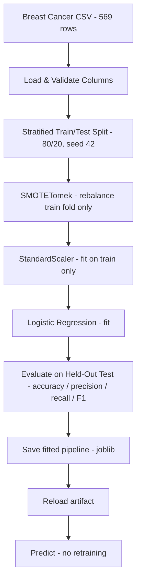
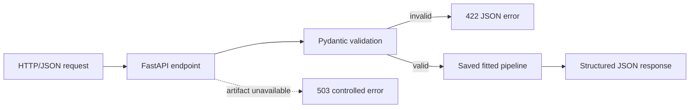

# 🎗️ ML Production Project — Breast Cancer Classification

[](https://www.python.org/)
[](https://scikit-learn.org/)
[](https://imbalanced-learn.org/)
[](https://docs.astral.sh/uv/)
[](https://fastapi.tiangolo.com/)
[](https://docs.pydantic.dev/)
[](https://docs.astral.sh/ruff/)
[](https://github.com/psf/black)
[](LICENSE)

**ML Production Project** is a production-ready **binary classification** application that predicts whether a breast tumor is **malignant** or **benign** from 30 cytological measurements. The project began as an experimentation notebook (`notebooks/01_exploration.ipynb`) and was refactored into a clean, reproducible Python package: environment-driven configuration, structured logging, a leakage-safe scikit-learn pipeline saved with joblib, and a `train` / `predict` CLI that serves the saved artifact without retraining.

**Assignment 02** extends the same project — same dataset, same fitted pipeline, same repository — with a **FastAPI service** that exposes the saved model over HTTP. Requests are validated by **Pydantic**, so malformed or out-of-range inputs are rejected before they ever reach the model, and the model is loaded once and reused rather than retrained per request.

---

## ✨ Key Features

### 📓 1. Notebook-First Experimentation → Production Modules
- Stage A lives in `notebooks/01_exploration.ipynb`: EDA, null/outlier checks, class distribution, 7-model comparison, and metric plots — the full experimentation record.
- Stage B moves only the tested logic into the `production_app/` package (data, preprocessing, training, evaluation, model service, config, logging) — the modules are the source of truth; the notebook is never imported by the app.

### 🛡️ 2. Leakage-Safe Training Pipeline
- A single `imblearn.pipeline.Pipeline` chains **SMOTETomek → StandardScaler → Logistic Regression**.
- The sampler and scaler only learn during `fit` on training data; `predict` skips the sampler and applies the already-fitted transform — no test data ever leaks into training.
- `SMOTETomek` rebalances the 63/37 class imbalance (benign/malignant) inside the training fold only.

### ⚙️ 3. Config-Driven Train / Predict CLI
- Every runtime setting (dataset path, model artifact path, log level, environment, test size, random seed) is read from environment variables into a single frozen `Settings` dataclass (`production_app/config.py`), exposed as `settings` — nothing is hardcoded.
- `uv run run.py train` fits, evaluates, saves the pipeline, and verifies the save/reload roundtrip.
- `uv run run.py predict` loads the saved artifact and predicts — **no retraining**, ever.

### 🧰 4. Reproducible & Code-Quality Enforced
- **uv** manages Python 3.14, dependencies, and the lockfile (`uv.lock` committed) — `uv sync` reproduces the exact app environment, and `uv sync --group experiments` adds the notebook tooling.
- **Ruff**, **Black**, and **pre-commit** hooks are configured and passing; all operational events go through `logging` (no `print`).

### 🌐 5. Validated HTTP API (Assignment 02)
- `production_app/api.py` exposes `GET /health` and `POST /predict`; the endpoints stay thin and delegate all ML work to `model_service.py`.
- `production_app/schemas.py` declares the 30 required features as one reusable constrained type — non-negative and finite (`allow_inf_nan=False`) — with `extra="forbid"`, plus the response contract; negative, non-finite, missing, or unexpected input never reaches the model.
- `config.py` centralizes every setting in one frozen `@dataclass` (`settings`), still populated from `.env`.
- Failures are controlled: bad input → `422`, unloadable artifact → `503`, unexpected errors → `500` with a generic message (no stack traces, paths or secrets ever reach the client).

---

## 📖 From Notebook to Production

| Stage | Where | What |
|-------|-------|------|
| **Stage A — Experiment** | `notebooks/01_exploration.ipynb` | Load & inspect the dataset, encode the target, visualize distributions/outliers/correlations, train 7 classifiers (Logistic Regression, Random Forest, XGBoost, Decision Tree, Naive Bayes, KNN, SVC), compare metrics, save baseline pickles. |
| **Stage B — Engineer** | `production_app/` + `run.py` | Refactor the validated workflow into typed, logged, config-driven modules; ship **one** straightforward model (Logistic Regression) behind a joblib-saved pipeline; run training and prediction independently of the notebook. |

---

## 🏗️ ML Pipeline Architecture



---

## 📊 Evaluation Results

Held-out test set (20%, stratified, `RANDOM_STATE=42`):

| Metric | Value |
|--------|-------|
| **Accuracy** | **0.9737** |
| Precision (malignant) | 0.9756 |
| Recall (malignant) | 0.9524 |
| F1 (malignant) | 0.9639 |

Confusion matrix (`[[TN, FP], [FN, TP]]`):

```
[[71  1]
 [ 2 40]]
```

One false positive and two false negatives out of 114 test samples — recall on the malignant class is the clinically weighted number, and it is explicitly reported and logged on every training run.

---

## 🛠️ Technology Stack

### Core
- **Language**: Python 3.14
- **Environment & packaging**: [uv](https://docs.astral.sh/uv/) (`.venv` + `uv.lock`)

### ML / Data
- **Model**: scikit-learn Logistic Regression
- **Pipeline**: imbalanced-learn `Pipeline` (SMOTETomek + StandardScaler)
- **Serialization**: joblib (fitted pipeline artifact)
- **Data**: pandas, numpy — [Breast Cancer Wisconsin (Diagnostic)](https://www.kaggle.com/datasets/yasserh/breast-cancer-dataset), 569 rows × 32 columns, no missing values

### Experimentation (notebook only — `uv sync --group experiments`)
- Jupyter / ipykernel, nbconvert, Plotly, Seaborn, Matplotlib, XGBoost (model comparison)
- None of these are imported by `production_app/` or `run.py`; the production app installs and runs without them.

### Code Quality
- Ruff (lint), Black (format), pre-commit hooks

### API (Assignment 02)
- **FastAPI** + **Uvicorn** (HTTP service, auto-generated OpenAPI docs at `/docs`)
- **Pydantic v2** (request/response validation and typed schemas)

---

## 🚀 Getting Started

### Prerequisites
- **[uv](https://docs.astral.sh/uv/)** (installs and manages Python 3.14 automatically)
- **Git**

### 1. Repository Setup
```bash
git clone https://github.com/MarwanAbdellah/ML-Production_Project.git
cd ML-Production_Project
```

### 2. Install Dependencies
```bash
uv sync
```
That is everything the training CLI and the API need. Only if you want to re-run the exploration notebook, add the experimentation group:
```bash
uv sync --group experiments
```

### 3. Configure Environment
Copy the example environment file and edit values if needed (the app runs on safe defaults without a `.env`):
```bash
cp .env.example .env
```
```env
DATA_PATH=notebooks/kaggle/breast-cancer.csv
MODEL_PATH=models/model_pipeline.joblib
LOG_LEVEL=INFO
ENVIRONMENT=development
TEST_SIZE=0.2
RANDOM_STATE=42
```

| Variable | Default | Purpose |
|----------|---------|---------|
| `DATA_PATH` | `notebooks/kaggle/breast-cancer.csv` | Input dataset location |
| `MODEL_PATH` | `models/model_pipeline.joblib` | Saved pipeline artifact |
| `LOG_LEVEL` | `INFO` | Logging verbosity |
| `ENVIRONMENT` | `development` | Environment label (logged) |
| `TEST_SIZE` | `0.2` | Test fraction of the split |
| `RANDOM_STATE` | `42` | Seed for split + SMOTETomek |

These values are read once at import into a single frozen `Settings` dataclass (`production_app/config.py`) and consumed everywhere as `settings` (e.g. `settings.model_path`).

### 4. Train
```bash
uv run run.py train
```
Loads the dataset, splits, fits the pipeline, logs metrics + classification report + confusion matrix, saves `models/model_pipeline.joblib`, and verifies the save/reload roundtrip.

### 5. Predict with the Saved Artifact
```bash
# Default: predict on 5 sample rows from the dataset
uv run run.py predict

# Or on your own CSV with the same 30 feature columns
uv run run.py predict --input path/to/data.csv
```
Prediction loads the saved pipeline and runs inference — **no retraining**.

### 6. Serve the API
```bash
uv run uvicorn production_app.api:app --port 8000   # Ctrl+C to stop
```
Swagger UI: <http://127.0.0.1:8000/docs>. Full endpoint contract, examples and troubleshooting: [Assignment 02 — FastAPI Service](#-assignment-02--fastapi-service).

---

## 🌐 Assignment 02 — FastAPI Service

Assignment 02 extends **this same repository**. It adds a validated HTTP layer in front of the pipeline that Task 01 already fitted and saved: nothing is retrained or refitted inside a request.

### What Assignment 02 adds

| Item | Status | Purpose |
|------|--------|---------|
| `production_app/schemas.py` | **New** | Pydantic request/response models (30 features, class output) |
| `production_app/api.py` | **New** | FastAPI app implementing `/health` and `/predict` |
| `production_app/model_service.py` | Extended | `load_model()` now caches the artifact — loaded once, reused per request |
| `production_app/config.py` | Extended | All settings live in one frozen `Settings` dataclass |
| `pyproject.toml` / `uv.lock` | Updated | `fastapi` + `uvicorn[standard]` added with uv |
| Task 01 modules, dataset, CLI, notebook | Unchanged | Same features, order, labels, split, and saved artifact |

### Request flow



1. Uvicorn routes the request to `predict_endpoint` in `api.py`.
2. FastAPI parses the body into `PredictRequest` (`schemas.py`): the 30 Task 01 features, all required, typed as `float` and constrained to `>= 0`. Missing, non-numeric, or negative values get a `422` — the pipeline is never called.
3. `PredictRequest.to_frame()` builds a one-row DataFrame in the exact column order the artifact was fitted on; `model_service.predict()` runs inference through the fitted preprocessing (sampler skipped, scaler reused — no refitting).
4. The endpoint answers `200` with the predicted class, its readable label, and the malignant probability.
5. Model access goes through `model_service.load_model()`, which is cached with `lru_cache`: the joblib artifact is read once per process. A missing or corrupt artifact becomes a controlled `503`; unexpected errors become a generic `500`. Clients never see stack traces, filesystem paths or configuration values.

### Running the API

```bash
# 1. Install/refresh dependencies (adds fastapi + uvicorn)
uv sync

# 2. Ensure the saved artifact exists (already committed; this regenerates it if missing)
uv run run.py train

# 3. Start the service, then stop it with Ctrl+C
uv run uvicorn production_app.api:app --port 8000

# 4. Auto-generated documentation
#    http://127.0.0.1:8000/docs    -> Swagger UI
#    http://127.0.0.1:8000/redoc   -> ReDoc
#    http://127.0.0.1:8000/openapi.json
```

### `GET /health`

Reports whether the service can actually load its model artifact.

```bash
curl -i http://127.0.0.1:8000/health
```

```json
HTTP/1.1 200 OK
{"status": "ok", "model_loaded": true, "detail": null}
```

| Situation | Status | Body |
|-----------|--------|------|
| Artifact loads | `200` | `{"status": "ok", "model_loaded": true, "detail": null}` |
| Artifact missing or unreadable | `503` | `{"status": "unhealthy", "model_loaded": false, "detail": "model artifact unavailable"}` |

### `POST /predict`

Accepts **one** observation with the 30 Task 01 features. Every field below is required; all are non-negative numbers.

```bash
curl -X POST http://127.0.0.1:8000/predict \
  -H "Content-Type: application/json" \
  -d '{
    "radius_mean": 17.99, "texture_mean": 10.38, "perimeter_mean": 122.8,
    "area_mean": 1001.0, "smoothness_mean": 0.1184, "compactness_mean": 0.2776,
    "concavity_mean": 0.3001, "concave points_mean": 0.1471, "symmetry_mean": 0.2419,
    "fractal_dimension_mean": 0.07871, "radius_se": 1.095, "texture_se": 0.9053,
    "perimeter_se": 8.589, "area_se": 153.4, "smoothness_se": 0.006399,
    "compactness_se": 0.04904, "concavity_se": 0.05373, "concave points_se": 0.01587,
    "symmetry_se": 0.03003, "fractal_dimension_se": 0.006193, "radius_worst": 25.38,
    "texture_worst": 17.33, "perimeter_worst": 184.6, "area_worst": 2019.0,
    "smoothness_worst": 0.1622, "compactness_worst": 0.6656,
    "concavity_worst": 0.7119, "concave points_worst": 0.2654,
    "symmetry_worst": 0.4601, "fractal_dimension_worst": 0.1189
  }'
```

```json
HTTP/1.1 200 OK
{"prediction": 1, "label": "malignant", "probability": 0.9999999969426683}
```

| Field | Type | Meaning |
|-------|------|---------|
| `prediction` | `int` | `0` = benign, `1` = malignant (Task 01 labels) |
| `label` | `str` | Human-readable class: `benign` or `malignant` |
| `probability` | `float \| null` | Malignant probability; `null` when the model has no `predict_proba` |

Feature names are exactly the Task 01 dataset columns, in this order (the 6 names containing a space must be quoted in JSON):

```text
radius_mean, texture_mean, perimeter_mean, area_mean, smoothness_mean,
compactness_mean, concavity_mean, "concave points_mean", symmetry_mean,
fractal_dimension_mean, radius_se, texture_se, perimeter_se, area_se,
smoothness_se, compactness_se, concavity_se, "concave points_se", symmetry_se,
fractal_dimension_se, radius_worst, texture_worst, perimeter_worst, area_worst,
smoothness_worst, compactness_worst, concavity_worst, "concave points_worst",
symmetry_worst, fractal_dimension_worst
```

### Expected validation errors

Malformed input is rejected with `422` before inference, with a machine-readable `detail` array:

| Case | Response |
|------|----------|
| Missing feature | `{"detail": [{"type": "missing", "loc": ["body", "fractal_dimension_worst"], "msg": "Field required", ...}]}` |
| Non-numeric value (`texture_mean: "abc"`) | `{"detail": [{"type": "float_parsing", "loc": ["body", "texture_mean"], "msg": "Input should be a valid number, unable to parse string as a number", ...}]}` |
| Negative value (`radius_mean: -1`) | `{"detail": [{"type": "greater_than_equal", "loc": ["body", "radius_mean"], "msg": "Input should be greater than or equal to 0", "ctx": {"ge": 0.0}}]}` |
| Artifact unavailable (any valid request) | `503` `{"detail": "model artifact unavailable"}` |

### Troubleshooting

| Symptom | Cause / fix |
|---------|-------------|
| `/health` returns `503` | No artifact at `MODEL_PATH`. Run `uv run run.py train`, or point `MODEL_PATH` at the real file in `.env`. |
| `422` on a feature you are sure you sent | The 6 columns with a space need the exact dataset spelling: `"concave points_mean"`, `"concave points_se"`, `"concave points_worst"` (underscores are only used in Python). |
| Predictions look random | Column order/names must match Task 01 — send all 30 features; the schema enforces this. |
| `Address already in use` | Another process holds the port: `uv run uvicorn production_app.api:app --port 8001`. |
| Old model still served after retraining | `load_model()` caches per process — restart the API to pick up a newly trained artifact. |
| `ModuleNotFoundError: fastapi` | Dependencies are stale: `uv sync`. |

---

## 🧪 Testing & Verification

There is no separate test suite; verify the system with these checks:

1. `uv run run.py train` — exits 0, logs evaluation metrics (accuracy ≈ 0.97), and reports `Saved pipeline to models\model_pipeline.joblib` followed by `Save/reload roundtrip verified`.
2. `uv run run.py predict` — logs `Loaded pipeline from ...` and prints 5 predictions; no training logs appear.
3. Failure path: delete or rename `models/model_pipeline.joblib`, then `uv run run.py predict` — logs `Model artifact not found` and exits with code 1.
4. Code quality: `uv run ruff check .`, `uv run black --check .`, and `uv run pre-commit run --all-files` all pass.
5. Reproducibility: run `train` twice — identical metrics both times (everything is seeded).
6. API happy path: `uv run uvicorn production_app.api:app --port 8000`, then `curl -i http://127.0.0.1:8000/health` → `200` `{"status": "ok", "model_loaded": true, ...}`, and a valid `POST /predict` → `200` with `prediction`/`label`/`probability` (Swagger UI at `/docs` works too).
7. API validation: `POST /predict` with a missing feature, a non-numeric value (`"abc"`), a negative value, a non-finite value (`NaN` / `Infinity`), or an unexpected extra feature → `422` with a `detail` array before any inference happens.
8. API failure path: rename `models/model_pipeline.joblib`, restart the API, then `GET /health` and a valid `POST /predict` → `503` with a controlled body and no stack trace or local path disclosed. Restore the artifact afterwards.
9. Artifact integrity: the schema contract was checked against the fitted pipeline — `list(PredictRequest(**row).to_frame().columns) == list(model.feature_names_in_)`, and a known-benign row predicts `benign` while a known-malignant row predicts `malignant`.

---

## 📁 Project Structure

```text
ML-Production_Project/
├── notebooks/
│   ├── 01_exploration.ipynb        # Stage A: EDA, 7-model comparison, validation record
│   └── kaggle/
│       └── breast-cancer.csv       # Breast Cancer Wisconsin dataset (569 x 32)
├── production_app/                 # Stage B: production package (source of truth)
│   ├── __init__.py                 # Package marker
│   ├── config.py                   # Settings dataclass, populated from .env
│   ├── logging_config.py           # One shared logging setup + get_logger
│   ├── data.py                     # Load, validate, feature prep, stratified split
│   ├── preprocessing.py            # SMOTETomek -> StandardScaler -> LogReg pipeline
│   ├── training.py                 # Fit with timing + logging
│   ├── evaluation.py               # Accuracy / precision / recall / F1 + report
│   ├── model_service.py            # joblib save / cached load / predict
│   ├── main.py                     # run_training() / run_prediction() orchestration
│   ├── schemas.py                  # NEW (A02): Pydantic request/response validation
│   └── api.py                      # NEW (A02): FastAPI app - /health, /predict
├── models/
│   ├── model_pipeline.joblib       # Saved fitted pipeline (recreated by `train`)
│   └── joblib_models/              # Baseline pickles from the notebook (not served)
├── run.py                          # CLI entry point: train | predict [--input]
├── .env.example                    # Environment variable template
├── .gitignore                      # Ignores .venv, .env, caches, checkpoints
├── .pre-commit-config.yaml         # ruff + black + file-check hooks
├── pyproject.toml                  # Dependencies, dev tools, tool config
├── uv.lock                         # Locked reproducible environment
└── README.md                       # This file
```

---

## 👤 Author

**Marwan Abdellah**
- **GitHub**: [@MarwanAbdellah](https://github.com/MarwanAbdellah)
- **LinkedIn**: [Marwan Abdellah](https://www.linkedin.com/in/marwan-abdellah/)

---

## 📄 License

Distributed under the MIT License. See [`LICENSE`](LICENSE) for more information.
